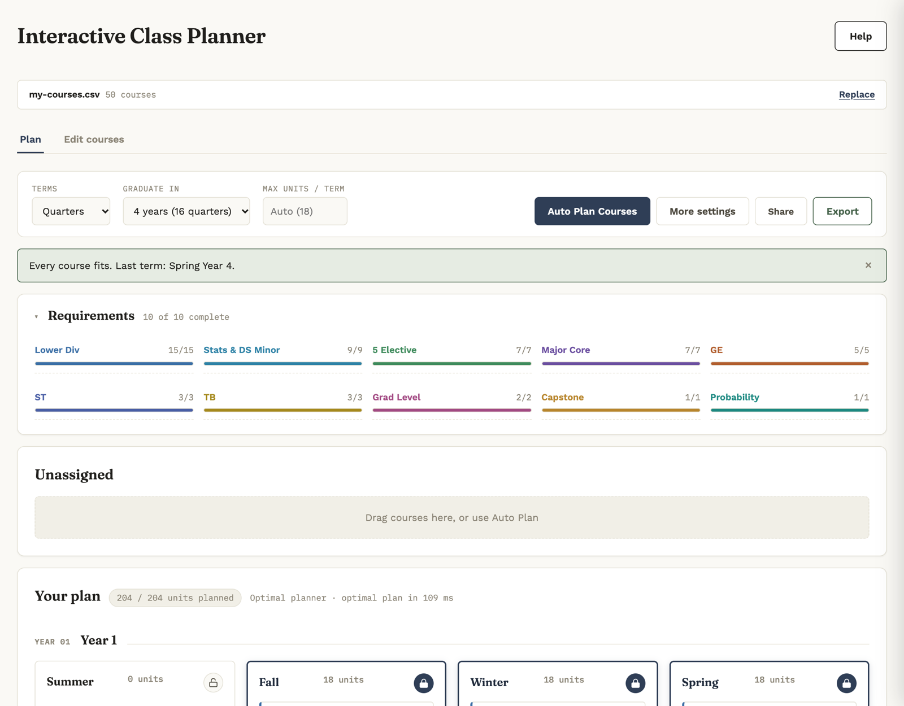

# Interactive Course Planner

Plan a whole college degree term by term. Upload your course list, and the planner builds a schedule that respects every prerequisite, corequisite, unit limit, and graduation requirement. It solves the schedule as an integer program in your browser. Then you adjust it by dragging (or tapping) courses around.

**Live app:** [daniellehonn.github.io/planmycourses](https://daniellehonn.github.io/planmycourses)



## What it does

- **Plans the whole degree at once.** The default planner models the schedule as a mixed-integer program and solves it with [HiGHS](https://highs.dev/) (WebAssembly, in a Web Worker). It places as many courses as possible, required ones first, as early as their prerequisites allow, and keeps each term near an even load. A greedy "Quick" planner is kept as a fallback.
- **Checks every placement.** Prerequisites (including either-or groups like `CS 31 / CS 31E`), corequisites, unit caps, locked terms, and pinned courses. Courses that break a rule turn red, and every unplaced course says why.
- **Tracks graduation requirements.** Set how many courses or units each category needs, and the planner stops adding courses once a requirement is met.
- **Works on phones.** Click or tap any course to see its prerequisites, what it unlocks, and where it can move.
- **Needs no account or server.** Plans save in your browser. **Share** copies a link that opens the same plan on any device, and **Export** writes a CSV that re-imports exactly.

## Results

The test suite runs both planners on 10 scenarios: the sample course list under four settings, five generated catalogs, and a hand-written edge case. Each resulting plan is checked against every scheduling rule. Optimal planner vs. the greedy Quick planner:

| | Quick (greedy) | Optimal (integer program) |
|---|---|---|
| Courses scheduled | 363 / 423 | **370 / 423** |
| Required courses left unscheduled | 7 | **5** (29% fewer) |
| Scenarios where it scheduled more | — | 4 of 10, never fewer |
| Units-per-term spread (std. dev., avg.) | 2.24 | **1.91** (more even in 7 of 10) |
| Proven optimal | — | 9 of 10 (the over-capacity stress case stops at the 10 s limit) |
| Rule violations (20 plans) | 0 | 0 |
| Median solve time | ~0.1 s | ~0.6 s |

Reproduce with `npm run compare` (details in [Testing](#testing)). Times vary from machine to machine.

## Quick start

1. Copy the [course list template](https://docs.google.com/spreadsheets/d/11h6T1080j6RTk9EUBoycZvgq-gj-Add7Y0oL3-ztW70/edit?usp=sharing) (**File → Make a copy**) and replace the sample rows with your courses. Leave unused rows blank.
2. Download it as CSV and click **Upload CSV**, or publish it (**File → Share → Publish to web → Comma-separated values**) and paste the link.
3. Pick quarters or semesters and how long you have to graduate. Max units per term is optional; blank means automatic.
4. Click **Auto Plan Courses**. If something doesn't fit, the status line explains why and offers to add a year or raise the unit cap.
5. Adjust: drag courses, or click one and choose **Move to…**. **Pin** a course to keep it in its term, or **lock** a whole term.
6. Click **Share** for a link, or **Export** for a CSV.

## Course sheet format

| Column | Required | Meaning |
|---|---|---|
| `Course Number` | yes | Course ID, e.g. `CS 35L`. Other columns refer to courses by this exact name. Rows without one are skipped. |
| `Prerequisites` | yes | Comma-separated; every entry is required. Use `/` for either-or: `CS 31 / CS 31E, MATH 31A` means one of CS 31 or CS 31E, plus MATH 31A. `None` if there are none. |
| `Description` | yes | Course title, shown on the card. |
| `Units` or `Difficulty` | at least one | Units per course. Difficulty (optional, e.g. 1–8) balances workload; if `Units` is missing, `Difficulty` is used as units. |
| `Corequisites` | no | Taken earlier or in the same term. Each pair must list each other. |
| `Req Satisfied` | no | Requirement category, e.g. `Major Core`, `GE`. Separate several with commas: `ST, Stats & DS Minor` counts toward both. Defaults to `Required`. |
| `Taken` | no | The term you took it, e.g. `Fall, Year 1`, or `Not Assigned`. The course is pinned there and **that term is locked**, so the planner treats it as done. |
| `Planned` | no | Written by Export: where the course sat in your plan. On import it goes back there, unpinned, so Auto Plan can still move it. |

Leave out courses you've already satisfied elsewhere (AP, IB, transfer credit), and don't list them as prerequisites.

## Graduation requirements

By default the planner schedules every course on your list. Under **More settings → Graduation requirements** you can set how many courses or units each category needs, for example 5 electives, or 0 courses of a minor you're not doing. The rule:

- A course is planned while **at least one of its categories still needs more**, or when a course that's still needed depends on it.
- So a course tagged `ST, Stats & DS Minor` is still planned when ST needs courses, even if the minor's target is 0.
- After planning, courses beyond a target are removed (latest first), as long as nothing depends on them. Courses taken only as prerequisites still count toward their own categories.
- Courses left out this way are listed as "Not needed — requirement already met".

## How planning works

**Optimal planner (default).** [`solver.js`](solver.js) builds a mixed-integer program, and [`solver-worker.js`](solver-worker.js) solves it with HiGHS 1.15.3 off the main thread.

- **Variables:** one yes/no variable per (course, open term). For the sample, that's about 300–600 variables.
- **Constraints:**
  - Each course is taken at most once.
  - Prerequisites come earlier and corequisites earlier or in the same term. Both are written in the cumulative "by term *t*" form, which solves much faster than the per-term form.
  - Each term stays under the unit cap.
  - Graduation requirements are modeled as capped slots, so every planned course either fills a needed slot or is a prerequisite of another planned course.
  - Pinned courses' prerequisites come first. This is soft, so the model is always solvable.
- **Objective:** maximize scheduled courses (required ≫ optional) and earliness (bottleneck and required courses weigh most), minus penalties for loads above the target or difficulty above the cap.
- **Safety net:** if the solver can't load, the app uses the Quick planner. If it hits its 10-second limit without proving optimality, the app also runs Quick and keeps whichever plan leaves fewer required courses (then fewer courses) unplaced.

**Quick planner.** The original greedy scheduler. It fills one open term at a time: from the courses whose prerequisites are done, it tries every combination of up to 5 that fits the unit budget and keeps the best-scoring one. Each course's priority:

```
priority = 10 × required courses it directly unlocks   +  6 × required courses it indirectly unlocks
         +  5 × elective courses it directly unlocks   +  3 × elective courses it indirectly unlocks
         +  8 × longest prerequisite chain starting here
         +  category weight (from the order in More settings → Category priority; 40, 35, 30, …)
         −  2 × difficulty
```

A combination also gets a large bonus per required course, a bonus per course (so a course that fits is never left out), and penalties for going over the difficulty cap or taking all-technical terms.

**Shared rules**

- **What stays put:** summer terms, locked terms, and pinned courses. Their courses count as completed only for later terms.
- **Automatic units:** max and target units per term spread the units still to plan over the terms still open. Max is at least 12, never below the largest course, and at most 22. **Balanced** aims for that target; **Fastest** packs terms up to the max plus 4.
- **Stale plans:** changing the timeline, term system, or units after planning marks the plan out of date and offers **Re-plan now**.

## Architecture

The app is a static site on GitHub Pages: [`index.html`](index.html), [`styles.css`](styles.css), [`script.js`](script.js), plus the solver files. There's no build step and no backend.

- **Data in:** an uploaded CSV/TSV, or a link to a published Google Sheet, read by a quote-aware parser that handles multi-line cells.
- **Saving:** the course list, plan, pins, and locks auto-save to `localStorage` on every change.
- **Share links:** the course list, plan, pins, locks, and planning settings are packed into the URL fragment (`#plan=`, deflate + base64url). That's about 2.3 KB for 50 courses. The fragment never reaches the server. Opening a link asks first if the browser already has a different plan.
- **Export:** a CSV with every field quoted. Taken courses go in `Taken`, and the rest of the plan goes in `Planned`.
- **Safety:** course text from a sheet is escaped before it's rendered.

## Testing

```
npm install        # one dev dependency: highs (the solver, for Node)
npm test           # 94 tests, Node's built-in test runner
npm run compare    # side-by-side table of both planners (add -- --json for raw numbers)
```

The suite loads the real `script.js` into a Node VM with a minimal fake DOM, so it tests the code the browser runs. The optimal planner uses the same problem-building and result-applying functions the Web Worker uses.

- [`tests/planners.test.js`](tests/planners.test.js) runs both planners on every scenario in [`tests/fixtures.js`](tests/fixtures.js). Every plan must pass every rule in [`tests/helpers/invariants.js`](tests/helpers/invariants.js):
  - each course appears once
  - prerequisites come earlier
  - corequisites come earlier or in the same term
  - the unit cap holds
  - locked terms and pins are untouched
  - every planned course is still needed for some requirement

  The optimal planner must also leave out no more required courses than Quick, and prove optimality outside the stress case.
- [`tests/regressions.test.js`](tests/regressions.test.js) has one test per fixed bug, including one built from a real plan a user shared.
- [`tests/share.test.js`](tests/share.test.js), [`tests/parsing.test.js`](tests/parsing.test.js), and [`tests/solver.test.js`](tests/solver.test.js) cover share links, CSV edge cases, and small solver models with known answers.
- Synthetic catalogs come from a seeded generator ([`tests/helpers/catalogs.js`](tests/helpers/catalogs.js)), so every run sees the same inputs.

CI ([`.github/workflows/test.yml`](.github/workflows/test.yml)) runs the suite on every push and posts the comparison table to the run summary.

## Project status

Tracked against the four-version roadmap from the project mentor (see the `Course Planner` project in et-al for the full breakdown).

| Version | Scope | Status |
|---|---|---|
| **V1 — Reliable planning engine** | Prerequisite/corequisite/unit validation, dependency graph, requirement tracking, feasibility checks | Built. Missing: per-course term offerings (`offered_terms`), duplicate-requirement detection. |
| **V2 — Personalized optimization** | Weighted scoring, optimal planning, plan variants | Built: integer-program planner, Balanced/Fastest modes, graduation targets. Missing: interest-based scoring, comparing alternative plans side by side. |
| **V3 — AI copilot** | Natural-language constraints, planning chat | Not started. Next step: turn requests like "keep Fall Y3 light" into constraint JSON for the solver. |
| **V4 — Recovery agent** | Re-plan when a course is unavailable, explain trade-offs | Not started. Per-course explanations exist: why a course is unplaced or flagged. |
| **Backend & database** | Persistence, plan versioning | Not needed so far: static site with browser storage and share links. An optional Supabase login existed briefly and was removed; see git history. |
| **Evaluation** | Benchmarks, metrics, user study | Benchmark suite, metrics, and CI built (see [Results](#results)). User study not started. |

## Files

- `index.html`, `styles.css`, `script.js`: the app
- `solver.js`, `solver-worker.js`: the optimal planner (integer-program model and HiGHS Web Worker)
- `tests/`: test suite and planner comparison
- `course_scheduler_algorithm_spec.md`: the original design spec for the greedy planner's scoring
- `DANIELLEHON-FINAL_*.csv`: sample course list (UCLA CS, quarter system)
- `img/`: screenshots for this README and the in-app help
